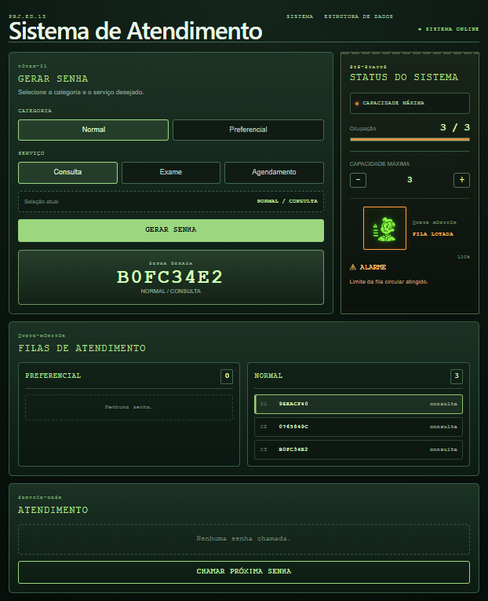
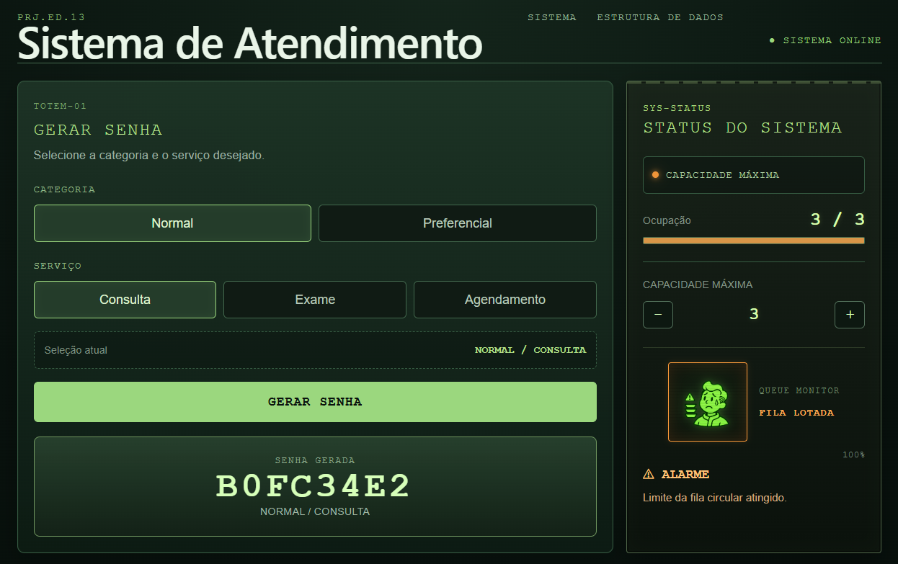
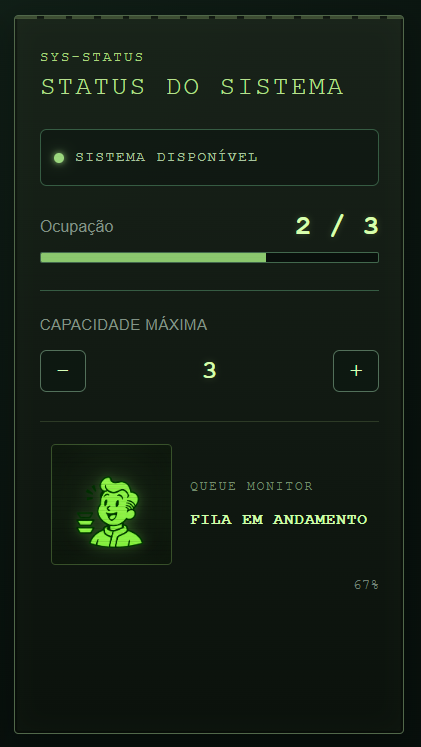
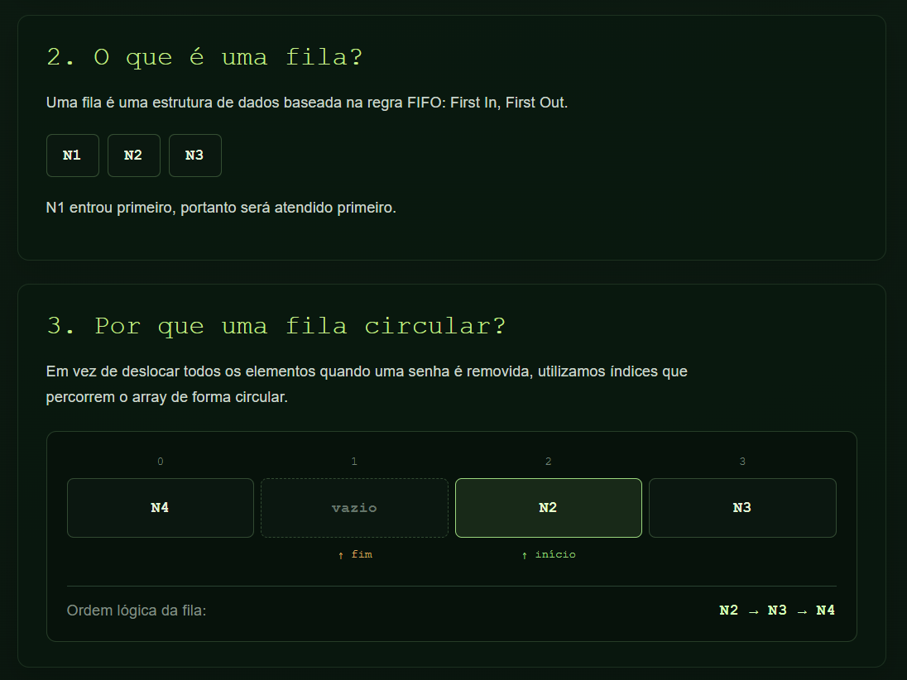
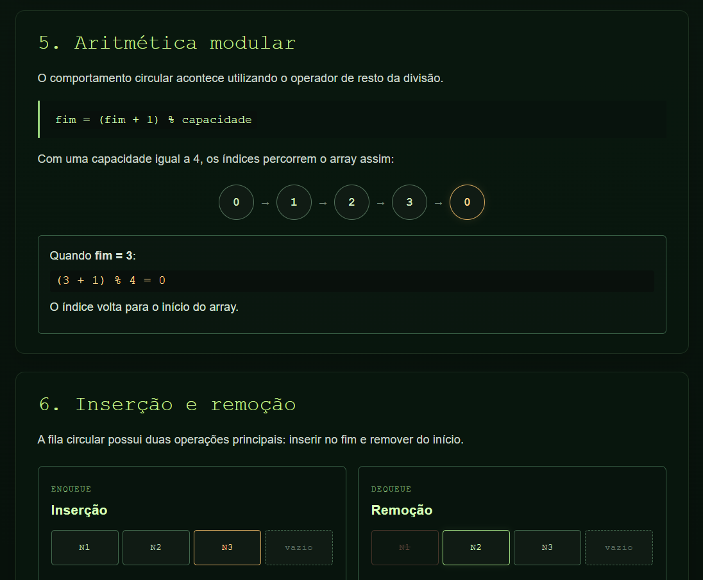

# Sistema de Atendimento por Senhas - PRJ.ED.13

Projeto acadêmico de Estrutura de Dados em TypeScript: sistema web para gerar, visualizar e atender senhas com prioridade para atendimento preferencial. Utiliza filas circulares implementadas com arrays e aritmética modular.

O repositório contém a lógica de atendimento, uma API Express e uma interface React com Vite.

## Regras do sistema

- Categorias: `normal` e `preferencial`.
- Serviços: `consulta`, `exame` e `agendamento`.
- Códigos aleatórios não sequenciais, com verificação de repetição na instância do sistema.
- Preferenciais sempre são chamadas antes das normais que ainda aguardam.
- Dentro de cada categoria, vale a ordem de geração: primeiro a entrar, primeiro a sair (FIFO).
- O serviço não altera a prioridade.
- A capacidade é total e compartilhada. Com limite 10, quatro preferenciais e seis normais ocupam todas as vagas.
- Novas senhas são bloqueadas quando o sistema está cheio.
- Uma inserção que ocupa a última vaga chama a função de alarme. Liberar uma vaga e preenchê-la novamente dispara outro aviso.

A capacidade inicial do servidor é **10**, definida em `src/server.ts`. A interface também permite alterar o limite durante a execução; essa funcionalidade estende a exigência de configuração inicial do enunciado.

## Arquitetura e tecnologias

| Parte | Responsabilidade |
| --- | --- |
| TypeScript e `FilaCircular<T>` | Array circular, índices, contador e redimensionamento |
| `SistemaAtendimento` | Prioridade, geração de códigos, capacidade compartilhada e callback de alarme |
| Node.js e Express | API HTTP com uma instância compartilhada pelas requisições |
| React e React Router | Totem, filas, atendimento, status e página explicativa |
| Vite | Desenvolvimento e build da interface |
| `tsx` e `concurrently` | Reinicialização do servidor e execução conjunta no desenvolvimento |
| Docker e Docker Compose | Padronização e execução isolada do frontend e backend |

```text
Navegador
   |
localhost:5173
   |
Container Frontend
   |
 HTTP / JSON
   |
localhost:3000
   |
Container Backend
   |
SistemaAtendimento
   |
+-------+-------+
|               |
FilaCircular   FilaCircular
preferencial     normal
```

As filas ficam em memória no servidor. Recarregar o navegador não apaga as senhas. Reiniciar o servidor, inclusive por uma alteração de código no modo watch, descarta o estado. Não há banco de dados.

## Estrutura de dados

`FilaCircular<T>` controla um array, o índice da próxima retirada (`inicio`), o índice da próxima inserção (`fim`), a quantidade ocupada e a capacidade.

```ts
this.fim = (this.fim + 1) % this.capacidade;
this.inicio = (this.inicio + 1) % this.capacidade;
```

O operador de resto permite voltar à posição zero depois da última posição. Inserções e retiradas não deslocam os outros elementos. A listagem usa `(inicio + i) % capacidade` para percorrer a ordem lógica.

Há um array por categoria, cada um com espaço para a capacidade configurada. O contador global impede que a soma das duas filas ultrapasse o limite compartilhado. Essa organização é uma decisão de implementação: o enunciado não detalha a distribuição do limite entre categorias.

O redimensionamento cria outro array, copia os elementos em ordem FIFO, redefine `inicio` para zero e calcula `fim` como `quantidade % novaCapacidade`. A redução abaixo da quantidade aguardando é bloqueada.

| Operação | Custo de tempo |
| --- | --- |
| Inserir ou retirar na fila circular | O(1) |
| Verificar se a fila está vazia ou cheia | O(1) |
| Atender a próxima senha | O(1) |
| Listar uma fila | O(n), pelos elementos nela presentes |
| Copiar os elementos no redimensionamento | O(n), além da criação do novo array |

A geração completa envolve sorteio e consulta ao `Set`, podendo repetir o sorteio em caso de colisão. Os dois arrays usam espaço proporcional à capacidade. O conjunto de códigos cresce com o histórico de senhas geradas.

## Organização dos arquivos

```text
fila-estruturaDeDados/
├── src/
│   ├── models/
│   ├── structures/
│   ├── services/
│   └── server.ts
│
├── front/
│   ├── src/
│   ├── Dockerfile
│   ├── .dockerignore
│   └── package.json
│
├── docs/
│   └── images/
│
├── Dockerfile
├── docker-compose.yml
├── .dockerignore
├── package.json
├── tsconfig.json
└── README.md
```

`dist/` contém o servidor e a lógica compilados. `front/dist/` contém a interface compilada. Dependências e saídas de compilação estão no `.gitignore`.

## Execução com Docker

O projeto pode ser executado de forma containerizada utilizando Docker e Docker Compose. Nesse modo, frontend e backend são executados em containers separados, mantendo o ambiente de desenvolvimento padronizado.

### Pré-requisitos

- Docker Desktop
- Docker Compose

### Iniciar o sistema

Na raiz do repositório, execute:

```powershell
docker compose up --build
```

Na primeira execução, o Docker irá:

1. construir a imagem do backend;
2. instalar as dependências do servidor;
3. construir a imagem do frontend;
4. instalar as dependências da interface;
5. iniciar os dois containers.

Após a inicialização, acesse:

- Interface: `http://localhost:5173/`
- Página explicativa: `http://localhost:5173/estrutura-dados`
- API: `http://localhost:3000/`

### Encerrar o sistema

```powershell
docker compose down
```

Depois que as imagens já tiverem sido construídas, o sistema pode ser iniciado novamente com:

```powershell
docker compose up
```

Durante o desenvolvimento, os diretórios `src` do frontend e backend são montados como volumes. Dessa forma, alterações realizadas nos arquivos TypeScript, TSX e CSS são detectadas pelos servidores de desenvolvimento sem a necessidade de reconstruir as imagens a cada modificação.

Mudanças em arquivos como `Dockerfile`, `package.json` ou dependências podem exigir uma nova construção:

```powershell
docker compose up --build
```

### Serviços

O `docker-compose.yml` mantém dois serviços:

```text
frontend
└── React + Vite
    └── porta 5173

backend
└── Node.js + Express
    └── porta 3000
```

O frontend continua realizando as requisições para `http://localhost:3000`, enquanto o backend permite requisições originadas de `http://localhost:5173`.

## Instalação e execução local

Use Node.js 24 e npm, ambiente adotado no desenvolvimento. Execute a partir da raiz do repositório:

```powershell
npm.cmd install
npm.cmd install --prefix front
npm.cmd run dev
```

O comando `dev` inicia o servidor e a interface juntos. Acesse:

- Interface: `http://localhost:5173/`
- Página de estudo: `http://localhost:5173/estrutura-dados`
- API: `http://localhost:3000/`

Para encerrar, pressione `Ctrl+C`. Também é possível executar em terminais separados:

```powershell
# Terminal 1: servidor
npm.cmd run dev:back
```

```powershell
# Terminal 2: interface
npm.cmd run dev:front
```

A interface usa endereços fixos com `http://localhost:3000` nas chamadas. O CORS do servidor permite a origem `http://localhost:5173`. Se o Vite escolher outra porta porque a 5173 está ocupada, libere essa porta ou ajuste as configurações necessárias.

O sufixo `.cmd` evita os scripts `.ps1` bloqueados em algumas configurações do PowerShell. Em outros terminais, pode-se usar `npm` e `npx`.

## Compilação e verificação

```powershell
# Verificar tipos do servidor e da lógica sem gerar arquivos
npx.cmd tsc --noEmit

# Compilar servidor e lógica em dist/
npm.cmd run build

# Executar demonstração manual
node dist/teste.js

# Verificar tipos e compilar interface em front/dist/
npm.cmd run build --prefix front
```

Após o build da raiz, `npm.cmd start` executa `dist/server.js`. Esse comando inicia somente a API: o servidor Express atual não serve os arquivos da interface. O build da raiz também compila somente `src/`; o frontend possui seu próprio comando de build.

`src/teste.ts` demonstra capacidade, erro de lotação, atendimento e novo disparo do alarme. É uma demonstração manual com mensagens no terminal. Não há script `npm test` nem uma suíte automatizada configurada.

## Uso da interface

1. No totem, selecione categoria e serviço e clique em **Gerar senha**.
2. A senha gerada é apresentada no ticket e adicionada à fila correspondente.
3. Confira as listas de atendimentos preferenciais e normais.
4. Clique em **Chamar próxima senha** para retirar a próxima pessoa da fila.
5. A chamada de uma nova senha é destacada visualmente por uma breve animação de interferência.
6. Acompanhe quantidade, capacidade e percentual de ocupação no painel de status.
7. Use `+` e `-` para alterar o limite, respeitando a quantidade atualmente aguardando.
8. Ao atingir a capacidade máxima, o sistema apresenta alertas visuais e tenta emitir um aviso sonoro.

As filas e o status são consultados ao abrir a página e após ações realizadas nela. Não há WebSocket ou consulta periódica; outra janela pode precisar recarregar para mostrar mudanças feitas por um cliente diferente.

## Interface do sistema

A interface foi desenvolvida com uma identidade visual inspirada em terminais e equipamentos eletrônicos antigos, utilizando tons escuros, verde fosforescente, elementos de monitor CRT e indicadores de estado.

### Visão geral



A tela principal reúne o totem de geração, visualização das filas, atendimento e informações sobre ocupação do sistema.

### Geração de senha



O usuário seleciona a categoria e o serviço antes de gerar uma senha. O ticket gerado apresenta uma pequena animação de interferência inspirada em monitores CRT, reforçando visualmente a criação de uma nova senha.

### Status do sistema



O painel de status apresenta quantidade de senhas aguardando, capacidade máxima, percentual de ocupação e alertas.

A interface também utiliza diferentes estados visuais para representar a ocupação da fila. Quando a capacidade máxima é atingida, são exibidos indicadores visuais e um alerta sonoro.

### Estrutura de dados





O projeto possui uma página dedicada à explicação visual da estrutura utilizada, apresentando conceitos como FIFO, índices `inicio` e `fim`, aritmética modular, prioridade e redimensionamento da fila circular.


## API HTTP

Base: `http://localhost:3000`. Corpos de requisição usam JSON com o cabeçalho `Content-Type: application/json`.

| Método | Rota | Entrada | Resposta de sucesso |
| --- | --- | --- | --- |
| GET | `/` | Sem corpo | Mensagem de funcionamento |
| POST | `/api/senhas` | `categoria` e `servico` | 201; senha gerada |
| GET | `/api/filas` | Sem corpo | 200; listas `preferenciais` e `normais` |
| POST | `/api/atendimento/proxima` | Sem corpo | 200; senha retirada |
| GET | `/api/status` | Sem corpo | 200; `quantidade`, `capacidade` e `lotada` |
| PATCH | `/api/configuracao/capacidade` | `capacidade` | 200; quantidade e capacidade atuais |

Exemplo de corpo para gerar senha:

```json
{
  "categoria": "preferencial",
  "servico": "exame"
}
```

Exemplo de alteração de capacidade:

```json
{
  "capacidade": 15
}
```

Geração com sistema cheio e redução abaixo da ocupação retornam 400 com `{ "erro": "mensagem" }`. Atendimento sem senhas retorna 404. Os tipos TypeScript não validam o JSON recebido automaticamente; há pendências de validação descritas adiante.

## Métodos da lógica

| Classe | Método | Função |
| --- | --- | --- |
| `FilaCircular<T>` | `estaVazia()` / `estaCheia()` | Consultar estado da fila |
| `FilaCircular<T>` | `enfileirar(elemento)` | Inserir no fim ou lançar erro se cheia |
| `FilaCircular<T>` | `desenfileirar()` | Retirar o primeiro ou retornar `undefined` |
| `FilaCircular<T>` | `listar()` | Obter elementos em ordem sem removê-los |
| `FilaCircular<T>` | `alterarCapacidade(novaCapacidade)` | Copiar para outro array preservando a ordem |
| `SistemaAtendimento` | `gerarSenha(categoria, servico)` | Gerar e inserir na categoria correspondente |
| `SistemaAtendimento` | `atenderProxima()` | Atender preferencial primeiro; retornar `undefined` se vazio |
| `SistemaAtendimento` | `consultarFilas()` | Obter as duas listas |
| `SistemaAtendimento` | `consultarQuantidade()` / `consultarCapacidade()` | Consultar ocupação e limite total |
| `SistemaAtendimento` | `alterarCapacidade(novaCapacidade)` | Redimensionar as duas filas e atualizar o limite global |

Os códigos usam os primeiros oito caracteres de `crypto.randomUUID()`, convertidos para maiúsculas. O `Set` impede aceitar códigos já registrados naquela instância, inclusive de senhas atendidas. O código identifica a senha; a posição na fila determina a ordem.

O callback do construtor continua opcional na lógica. O servidor fornece uma função que escreve no console. O aviso visual e sonoro do frontend é acionado separadamente ao observar `status.lotada`.
